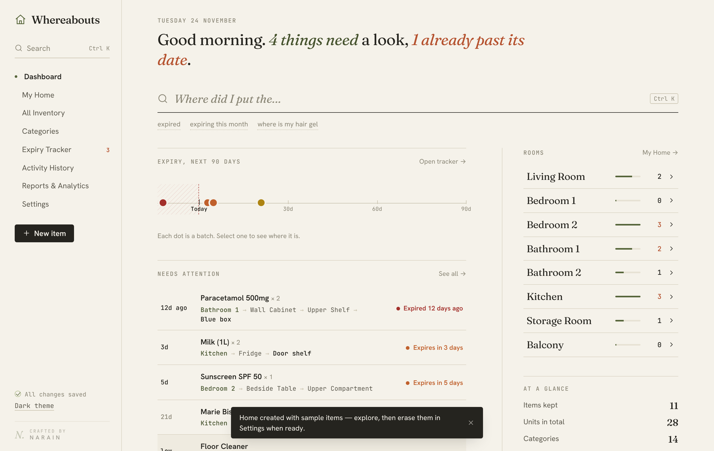
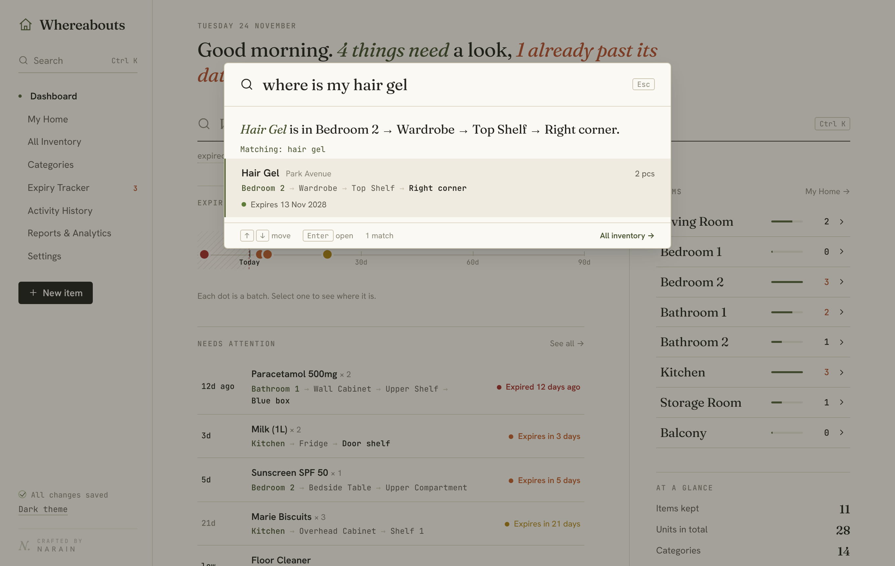
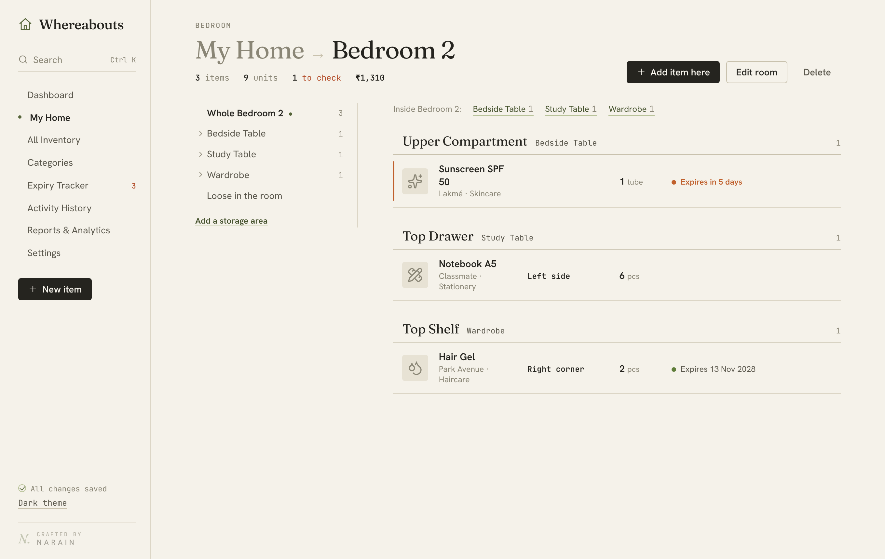
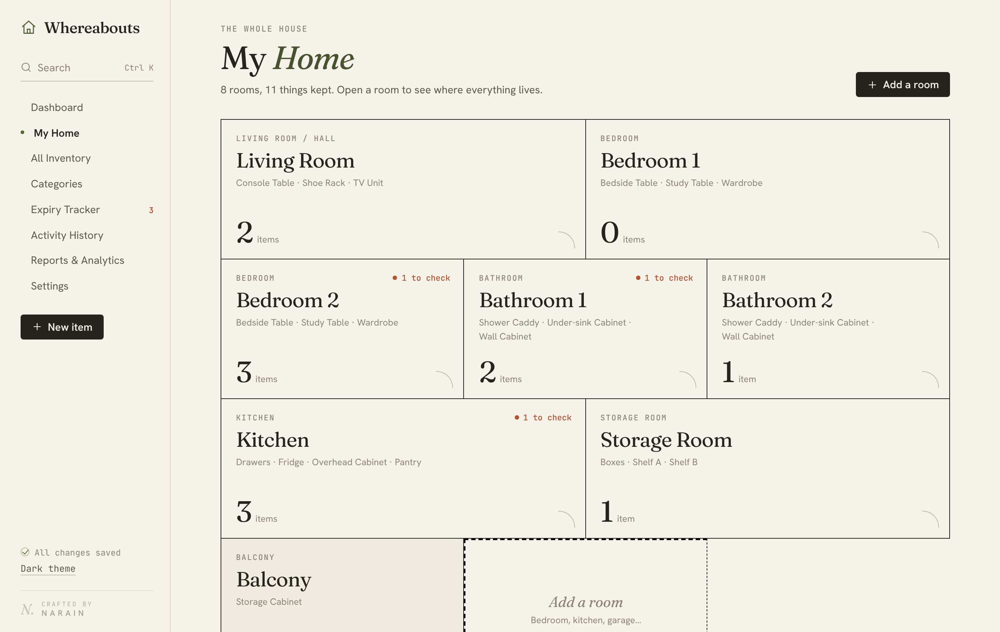
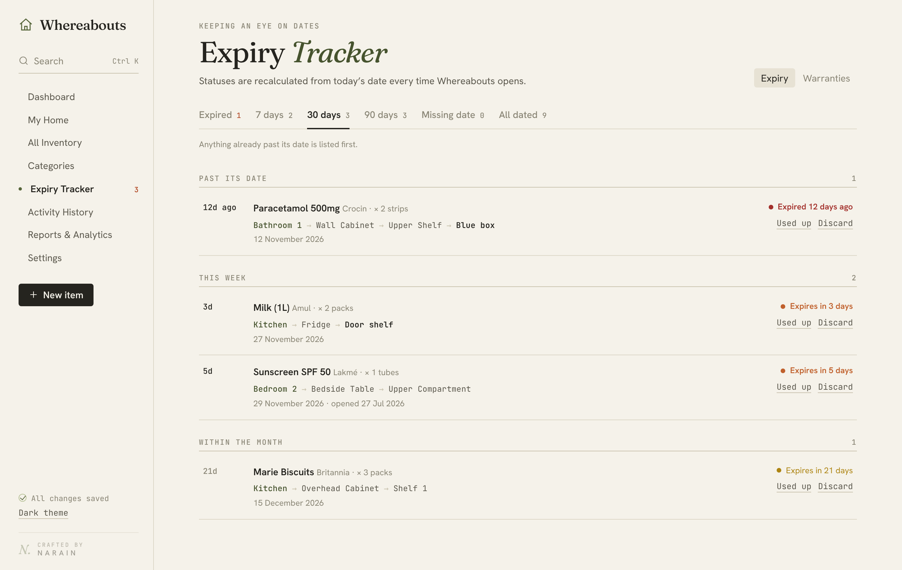
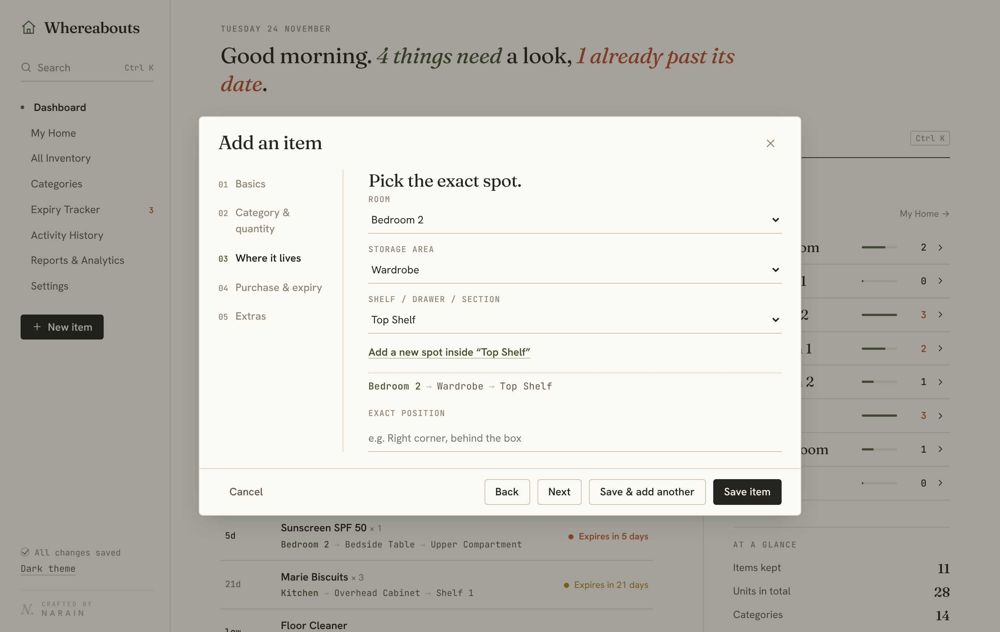
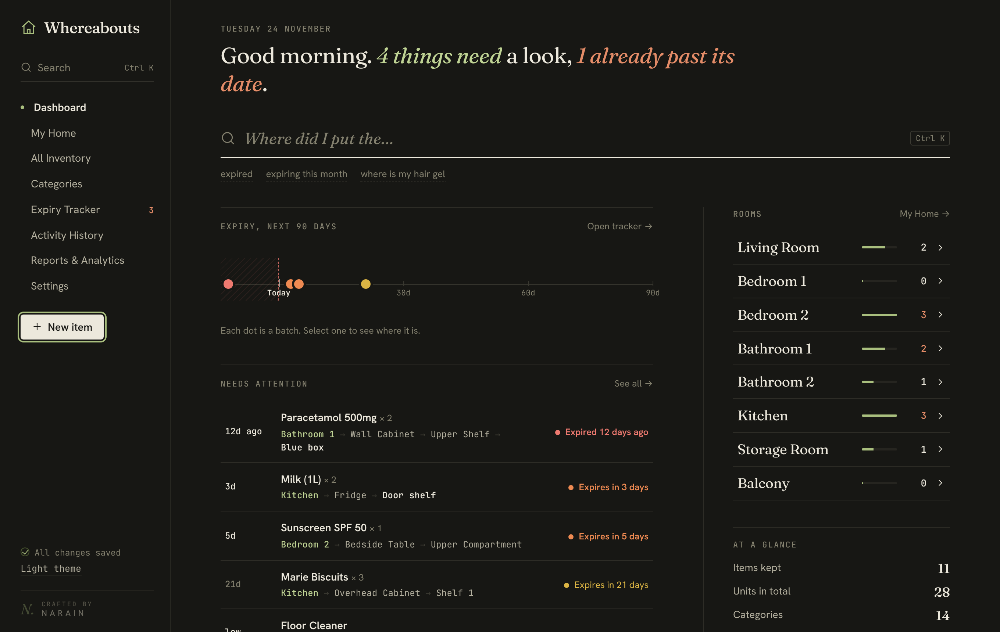

<div align="center">


# Whereabouts

**Know exactly where everything in your home is, and what's about to expire.**

*"Where did I put the hair gel?"* → **Bedroom 2 → Wardrobe → Top Shelf → Right corner**


<br>



</div>

<br>

## The story

I kept losing small things at home and buying duplicates of what I already owned. Most inventory apps tell you *what* you have. I wanted one that tells me *where it is*, down to the shelf and corner, and warns me before it expires.

So I built it, and tried to design it like a real product rather than a generic dashboard: warm paper tones, editorial type, and a calm interface that stays out of the way. Everything runs on your own computer, with no account and no cloud.

<br>

## Highlights

| | |
|---|---|
| 🗺️ **Map your home** | Rooms with storage spots nested to any depth, from room to wardrobe to shelf to exact corner. |
| 🔎 **Ask, don't hunt** | Press `Ctrl+K` and type *"where is my black HDMI cable?"*. You get the exact location, quantity and expiry. |
| ⏳ **Never waste food or medicine** | A 90-day expiry timeline, colour-coded status, adjustable thresholds and optional reminders. |
| 📦 **Batches done right** | The same item can have different expiry dates and live in different places. |
| ✍️ **A form that gets out of your way** | Five short steps. Expiry, warranty or maintenance fields appear only when the category needs them. |
| 🧾 **A full logbook** | Every add, move and quantity change is recorded. |
| 💾 **Safe by default** | JSON and CSV backup, automatic safety copies before risky actions, and your data never leaves your machine. |
| 🌗 **Light and dark** | Both themes are fully designed, with keyboard support and reduced-motion respect. |

<br>

## A look around

<table>
<tr>
<td width="50%"><br><sub><b>Ask in plain English.</b> Press Ctrl+K from anywhere.</sub></td>
<td width="50%"><br><sub><b>Explore a room.</b> An outline of storage spots, with items grouped by shelf.</sub></td>
</tr>
<tr>
<td width="50%"><br><sub><b>My Home.</b> Every room at a glance.</sub></td>
<td width="50%"><br><sub><b>Expiry tracker.</b> What needs you, grouped by when.</sub></td>
</tr>
<tr>
<td width="50%"><br><sub><b>Add an item.</b> Five calm steps, with a live location preview.</sub></td>
<td width="50%"><br><sub><b>Dark theme.</b> Equally polished.</sub></td>
</tr>
</table>

<br>

## Get started

### Windows (no install)

1. Download the latest zip from [**Releases**](../../releases) and unzip it somewhere permanent, such as `C:\Users\<you>\Whereabouts`.
2. Double-click **`Create-Desktop-Shortcut.bat`** once. A Whereabouts icon appears on your Desktop.
3. Open it any time. It runs in its own window and stops quietly when you close it.

Optional: **`Add-To-Windows-Startup.bat`** starts it minimised at sign-in so expiry notifications can appear without opening the app.
If PowerShell is blocked by your organisation, use **`Open-Without-Server.bat`**.

### Any OS

```bash
git clone https://github.com/Narain0024/whereabouts.git
cd whereabouts
python -m http.server 5179
# then open http://localhost:5179
```

There is no build step and no dependencies. Any static file server works.

<br>

## Using it

<details>
<summary><b>Quick tour</b></summary>

- **First run:** choose how many of each room you have, then *Create my home*. You can add common storage spots too, or try the sample items.
- **My Home → open a room:** add, rename or delete storage spots at any depth. The breadcrumb always shows where you are.
- **Add item** (button, or press `N`): only the name and quantity are required. The category is suggested from the name.
- **Batches:** units with different expiry dates or places become separate batches. Moving part of a batch splits it.
- **Quick stock:** −1 / +1 on any row, or *Stock…* to add, use, discard or set an exact count.
- **Search:** `/` or `Ctrl+K`. Try *"skincare in bedroom 2"*, *"food expiring in 30 days"* or *"how many cleaning products"*. It's rule-based, works offline, and forgives typos.
- **Expiry colours:** olive is safe, ochre is within 30 days, terracotta within 7 days, and brick red is expired. Thresholds are in Settings.
- **Backup:** JSON restores everything. CSV opens in Excel and can be re-imported.

</details>

<details>
<summary><b>Keyboard shortcuts</b></summary>

| Key | Action |
|---|---|
| `Ctrl+K` or `/` | Search |
| `N` | New item |
| `Esc` | Close dialogs |

</details>

<details>
<summary><b>Where is my data?</b></summary>

In your browser's local database (IndexedDB) for `http://localhost:5179`, saved automatically after every change. It survives closing the app and restarting your computer.

**Clearing browser "site data" erases it**, so export a JSON backup now and then from *Settings → Backup & restore* and keep a copy in OneDrive or on a USB drive. Safety copies are also made automatically before risky actions and once a day, and you can restore them from *Settings → Safety copies*.

</details>

<details>
<summary><b>Project layout</b></summary>

```
index.html              app shell
css/styles.css          design system, themes, layout
js/db.js                IndexedDB layer
js/store.js             data model, validation, history, snapshots, import
js/expiry.js            status maths
js/search.js            search and natural-language parser
js/backup.js            JSON / CSV export and import
js/items.js             rows, item form, stock and move dialogs, drawer
js/ui.js                toasts, dialogs, small components
js/views/*.js           one file per screen
js/app.js               shell, router, command palette
sw.js                   offline cache
server.ps1              tiny localhost server (Windows built-ins only)
tests/                  unit and end-to-end tests
```

Data model: **rooms → locations (any depth) · categories (with subcategories) · items → batches** (a batch is a set of units sharing one expiry date and one place) · **activity** log.

</details>

<br>

## Built with

Plain **HTML, CSS and JavaScript**, with no framework and no build tooling. It uses IndexedDB for storage and a service worker for offline use. Type is set in **Fraunces**, **Hanken Grotesk** and **JetBrains Mono**, all bundled so it works offline.

## Tests

```bash
npm i playwright
node tests/unit.js
node tests/e2e.mjs
```

## Roadmap

- [ ] Automatic backup to a folder you choose
- [ ] Quick-add mode for adding many items at once
- [ ] QR labels for shelves and boxes
- [ ] A shopping list that builds itself

Have an idea or found a bug? [Open an issue](../../issues).

## License

Released under the [MIT License](LICENSE).

Icons by [Lucide](https://lucide.dev) (ISC). Fonts under the SIL Open Font License.

<br>

<div align="center">
<sub>Crafted by <b>NARAIN</b></sub>
</div>
